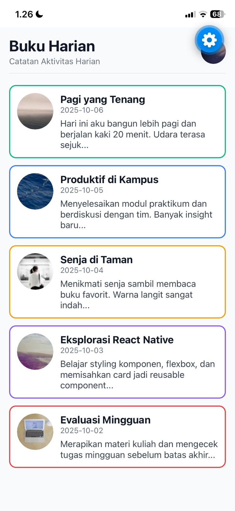

# Diary App - Praktikum 02

Aplikasi Buku Harian sederhana berbasis React Native dan Expo CLI yang dikembangkan sebagai tugas praktikum Mobile Programming.

## Identitas Mahasiswa
- **Nama:** Afdhal Tsany Nurrizki
- **NIM:** 2430511078
- **Kelas:** B

---

## Fitur & Poin Praktikum yang Diselesaikan
- **Struktur Komponen Dasar:** Menggunakan `ScrollView`, `View`, `Text`, dan `Image` untuk menyusun daftar catatan.
- **Component Reusability:** Memecah kartu catatan menjadi komponen terpisah (`src/components/DiaryCard.js`) dengan parsing data dinamis via `props`.
- **Kelengkapan Data:** Menampilkan 5 entri catatan harian dengan judul, tanggal, dan preview teks.
- **Header Khusus:** Dilengkapi avatar pengguna pada bagian header.
- **Dinamika Visual:** Variasi warna border kartu diary berdasarkan kategori mood.
- **Aset Gambar:** Menggunakan URL gambar jarak jauh (*remote image*) via `picsum.photos` dan penanganan safe area screen.

---

## Lingkungan Pengembangan & Pengujian
- **Editor:** Visual Studio Code
- **Framework:** React Native (Expo CLI)
- **Device Pengujian:** Apple iPhone (iOS Device Fisik via Expo Go)
- **Target SDK:** Expo SDK 57 / React Native 0.79

> **Catatan Pengujian di iOS:**
> Proyek disesuaikan agar kompatibel dengan aplikasi Expo Go versi terbaru di iOS (SDK 57) dan menggunakan layout `SafeAreaView` agar UI tidak tertimpa status bar maupun notch iPhone.

---

## Screenshot Aplikasi
